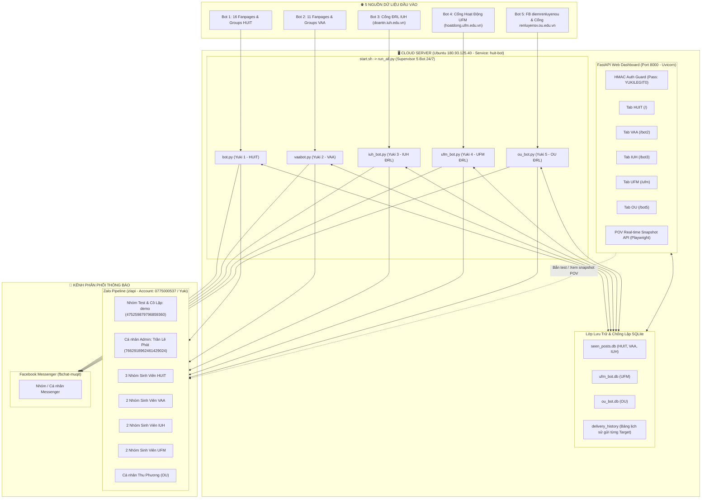

# 🏛️ TỔNG QUAN KIẾN TRÚC HỆ THỐNG PENTA-BOT 24/7 (YUKI ECOSYSTEM)
> ⚠️ **TÀI LIỆU BẮT BUỘC PHẢI ĐỌC TRƯỚC KHI CAN THIỆP HỆ THỐNG**
> **Mục đích:** Lưu trữ 100% cấu trúc kiến trúc, bảng tra cứu ID, thuật toán chống trùng lặp, quy định cách ly và các lệnh vận hành của hệ thống 5 Bot (HUIT, VAA, IUH, UFM, OU).
> **Dành cho AI & Lập trình viên:** Đọc tài liệu này giúp nắm trọn bối cảnh trong 1 lượt đọc, **không cần quét lại mã nguồn hàng chục file và tiết kiệm token tối đa**.

---

## 🗺️ 1. SƠ ĐỒ KIẾN TRÚC TOÀN HỆ THỐNG



---

## ⚙️ 2. BẢNG ĐẶC TẢ CHI TIẾT 5 CON BOT (PENTA-BOT MATRIX)

| Tiêu chí | Bot 1: Yuki 1 (HUIT) | Bot 2: Yuki 2 (VAA) | Bot 3: Yuki 3 (IUH) | Bot 4: Yuki 4 (UFM) | Bot 5: Yuki 5 (OU) |
| :--- | :--- | :--- | :--- | :--- | :--- |
| **Trường** | ĐH Công Thương TP.HCM | Học viện Hàng Không VN | ĐH Công Nghiệp TP.HCM | ĐH Tài chính - Marketing | ĐH Mở TP.HCM |
| **File thực thi** | `bot.py` | `vaabot.py` | `iuh_bot.py` | `ufm_bot.py` (và `vaa/ufm/bot.py`) | `ou_bot.py` |
| **File cấu hình** | `config.json` | `config_bot2.json`, `vaabot.json`, `vaa/config.json` | `config_iuh.json` | `config_ufm.json`, `vaa/ufm/config.json` | `config_ou.json` |
| **Nguồn cào** | 16 Fanpages/Groups HUIT | 11 Fanpages/Groups VAA | `doantn.iuh.edu.vn/doanvien.html` | Duy nhất: `hoatdong.ufm.edu.vn/DangKy` | FB `diemrenluyenou` & Cổng `renluyensv.ou.edu.vn` |
| **Cơ chế xác thực** | Cookie Facebook Desktop | Cookie Facebook Desktop | Session Cookie + OCR Captcha (`ddddocr`) | Form Auth + Session Cookie (`focusoncareer2111`) | Cookie FB + SSO Captcha AI (`2654092020`) |
| **Database** | `seen_posts.db` | `seen_posts.db` (`bot2_posts`) | `seen_posts.db` (`iuh_posts`) | `ufm_bot.db` | `ou_bot.db` |
| **Chu kỳ quét** | 60 giây | 60 giây | 120 giây | 180 giây | 25 - 30 giây |
| **Route Web UI** | `/` (Trang chủ) | `/bot2` | `/bot3` | `/ufm` | `/bot5` |
| **Tính năng POV** | - | - | Có (Nút POV Cổng IUH) | Có (Nút POV Cổng UFM) | Có (Nút POV Cổng OU) |

---

## 📱 3. DANH BẠ THREAD ID ZALO TOÀN HỆ THỐNG

### 3.1. Tài khoản Bot Phát Tin (Sender)
- **Tên hiển thị:** Yuki (UID: `637058638692425903`)
- **Số điện thoại:** `0775000537`

### 3.2. Kênh Thử Nghiệm & Cô Lập Tuyệt Đối (Test Isolation)
> ⚠️ **QUY ĐỊNH BẮT BUỘC:** Mọi thao tác bấm nút Test trên Web Dashboard, debug gửi tin, bắn tin mẫu, hoặc cảnh báo thử nghiệm **CHỈ ĐƯỢC PHÉP GỬI DUY NHẤT** tới:
- **Cá nhân Admin:** Trần Lê Phát - Thread ID `7662918962461429024` (Type: `USER`)
- ⛔ **Tuyệt đối KHÔNG gửi tin test vào nhóm demo (`475259879796859360`)**.
- ⛔ **Tuyệt đối KHÔNG gửi tin test/bản mẫu vào các nhóm sinh viên thật.**

### 3.2.1. Cấu hình Tự động Đăng ký Bot 5 (OU)
- Tính năng tự động đăng ký của Bot 5 đã được **TẮT HOÀN TOÀN** (`auto_register: false`).
- Bot 5 chỉ đóng vai trò quét phát hiện sự kiện mới trên Cổng ĐRL OU và Fanpage để gửi thông báo kịp thời cho sinh viên (Thu Phương & Admin), không tự ý nộp đơn đăng ký.

### 3.3. Các Nhóm Chính Thức Nhận Thông Báo Của Sinh Viên
| Bot | Tên hiển thị trong Zalo | Thread ID | Loại |
| :--- | :--- | :--- | :--- |
| **Bot 1 (HUIT)** | `Săn drl Hu ít` | `7086011981379160878` | `GROUP` |
| **Bot 1 (HUIT)** | `Thông báo drl` | `979670734727637728` | `GROUP` |
| **Bot 1 (HUIT)** | `Thông báo ‼️` | `6036269726715046333` | `GROUP` |
| **Bot 2 (VAA)** | `Tbao đrl VAA` | `3211449471524750057` | `GROUP` |
| **Bot 2 (VAA)** | `TBao Skien , ĐRL Vaa -` | `387016397668099110` | `GROUP` |
| **Bot 3 (IUH)** | `TB điểm rèn luyện IUH` | `6906603484437051809` | `GROUP` |
| **Bot 3 (IUH)** | `IUH-TBAO DRL` | `4567863637705237532` | `GROUP` |
| **Bot 4 (UFM)** | `Tbao , đky sự kiện UFM` | `3790417084788199906` | `GROUP` |
| **Bot 4 (UFM)** | `Ufm và canh bạc drl` | `2349841347887711204` | `GROUP` |
| **Bot 5 (OU)** | `Thu Phương` | `2565765564417722339` | `USER` |

### 3.4. Danh sách các nhóm & Target đã bị xóa vĩnh viễn (KHÔNG BAO GIỜ THÊM LẠI)
1. `Huit _CTV BOT tbao Zalo` (`6270243835909820050`) - Đã xóa theo yêu cầu.
2. `TSTD Huit 2027` (`8647983209102501525`) - Đã xóa theo yêu cầu.
3. `Thông báo P. CTSV HUIT 2` (`3098651132176283286`) - Đã xóa theo yêu cầu.
4. `Marketing K26 – HUIT` (`3777114335248827133`) - Đã xóa theo yêu cầu.
5. Target Facebook #14: `Yu Ki (FB Profile)` (`https://www.facebook.com/profile.php?id=61595329828799`) - Đã xóa khỏi danh sách cào Bot 2.

---

## 🛡️ 4. KIẾN TRÚC CHỐNG LẶP TIN (ANTI-DUPLICATE ARCHITECTURE)

Đây là thành phần cốt lõi đã được hoàn thiện để giải quyết triệt để 2 lỗi nghiêm trọng trong quá khứ:
1. *Lỗi bài Minigame chỉ gửi 1 người rồi tắt.*
2. *Lỗi hoạt động UFM mới mở không nổ chuông Zalo do bot tự khóa chính mình.*

### 4.1. Nguyên tắc vàng của cơ chế chống lặp
0. **Bảo vệ Cold-Start Baseline (Không spam khi khởi động lại):**
   - Khi bot khởi động lần đầu hoặc cơ sở dữ liệu rỗng (`seen_total == 0`), toàn bộ bài/hoạt động hiện có trên cổng (UFM, IUH, OU) được lưu vào DB với `is_sent = True` và `status = 'BASELINE'`.
   - Tuyệt đối không bắn thông báo cho các bài đã tồn tại từ trước chu kỳ đầu tiên.
   - Nghiêm cấm mọi điều kiện kiểm tra lỏng lẻo kiểu `if not old_is_sent and is_now_open:` kích hoạt gửi lại các bài baseline.
1. **`delivery_history` là Chân lý Duy nhất cho từng Người nhận (`target_id`):**
   - Bảng `delivery_history` lưu trữ chi tiết: `(post_id, zalo_target_id, status = 'SUCCESS')`.
   - Khi kiểm tra gửi cho nhóm $A$, bot chỉ hỏi: *"Nhóm $A$ đã nhận bài viết này thành công chưa?"*. Nếu chưa ➔ Bắt buộc phải gửi.
2. **Cờ toàn cục (`seen_activities.is_sent`, `crawled_posts.is_sent_zalo`) CHỈ được kiểm tra khi `target_id is None`:**
   - Tuyệt đối không kiểm tra cờ toàn cục khi đang duyệt danh sách từng nhóm.
   - Nếu kiểm tra cờ toàn cục khi gửi từng nhóm, ngay khi nhóm đầu tiên (hoặc tài khoản test) nhận tin, cờ toàn cục bật lên sẽ làm tất cả các nhóm còn lại bị chặn (bỏ qua).
3. **Thứ tự Ghi nhận Trạng thái Hoạt động:**
   - Khi phát hiện bài mới / hoạt động mới: Ghi nhận vào DB với `is_sent = False` (chưa gửi).
   - Tiến hành gọi `send_zalo_*` duyệt qua danh sách tất cả các nhóm được bật (`enabled: true`).
   - Sau khi vòng lặp gửi tin hoàn tất: Nếu có ít nhất 1 nhóm gửi thành công (`any_success = True`), mới cập nhật `is_sent = True`.
4. **Luôn chuẩn hóa `clean_text` trước các nhánh rẽ:**
   - Biến `clean_text` (nội dung bỏ tag `@All` để lưu vào DB) phải được gán giá trị mặc định ngay đầu vòng lặp duyệt target, không được để trong nhánh `is_user` tránh lỗi `UnboundLocalError`.

---

## 🖥️ 5. MÁY CHỦ CLOUD VPS & DỊCH VỤ 24/7 (SYSTEMD)

### 5.1. Thông số kết nối VPS
- **IP:** `180.93.125.40`
- **SSH Port:** `22`
- **User:** `root`
- **Mật khẩu:** `2tLGYzo2Ihgl6wKX`
- **Thư mục dự án:** `/root/huit-bot/`

### 5.2. Vì sao tắt laptop thì VPS và Bot KHÔNG bị tắt?
- Toàn bộ hệ thống chạy dưới dạng dịch vụ Linux ngầm: `huit-bot.service` (`/etc/systemd/system/huit-bot.service`).
- `systemd` tự động khởi chạy tiến trình khi VPS boot và tự động hồi sinh tiến trình sau 5 giây nếu có crash (`Restart=always`, `RestartSec=5`).
- Tiến trình chạy hoàn toàn độc lập trong nhân Linux của VPS, **không gắn với session SSH hay laptop cá nhân**.

### 5.3. Cấu trúc khởi động `start.sh`
```bash
# 1. Khởi chạy Web Dashboard ở chế độ nền
uvicorn web_app:app --host 0.0.0.0 --port 8000 &

# 2. Khởi chạy 5 Bot đồng thời qua run_all.py (foreground supervisor)
python -u run_all.py
```
`run_all.py` khởi tạo 5 luồng riêng biệt, mỗi luồng giám sát một tiến trình con (`subprocess.Popen`):
- Luồng 1: `bot.py` (HUIT)
- Luồng 2: `vaabot.py` (VAA)
- Luồng 3: `iuh_bot.py` (IUH)
- Luồng 4: `ufm_bot.py` (UFM)
- Luồng 5: `ou_bot.py` (OU)
Nếu bất kỳ bot nào gặp lỗi mạng văng ra, luồng giám sát sẽ tự động khởi động lại bot đó sau 5 giây mà không làm gián đoạn các bot khác.

---

## 🌐 6. WEB DASHBOARD & TÍNH NĂNG SNAPSHOT POV

- **Địa chỉ truy cập:** `http://180.93.125.40:8000/`
- **Mật khẩu:** `YUKILEGIT0` (Xác thực Cookie HMAC 30 ngày).
- **Tính năng POV Cổng Trường (Real-time Snapshot):**
  - Bot 3 (IUH), Bot 4 (UFM), Bot 5 (OU) có nút **"👁️ Xem Trực Tiếp Cổng Trường (POV)"** trên thanh điều khiển.
  - Sử dụng Playwright Headless chụp ảnh màn hình trang đăng ký bên trong đúng phiên làm việc (session/cookies) của bot và hiển thị modal trực quan cho admin.
  - Hỗ trợ nút **"Quét Ngay Lập Tức"** để kích hoạt chu kỳ quét cưỡng bức không cần đợi timer.

---

## ⚡ 7. BẢNG TRA CỨU LỆNH NHANH CHO AI & DEVELOPER

| Nhu cầu thao tác | Lệnh thực thi qua SSH / Local |
| :--- | :--- |
| **Khởi động lại toàn bộ hệ thống** | `systemctl restart huit-bot` |
| **Kiểm tra trạng thái 5 Bot & Web** | `systemctl status huit-bot --no-pager` |
| **Xem log trực tiếp thời gian thực** | `journalctl -u huit-bot -f` |
| **Xem 50 dòng log gần nhất** | `journalctl -u huit-bot -n 50 --no-pager` |
| **Kiểm tra cổng Web 8000** | `ss -tlpn \| grep 8000` |
| **Đồng bộ toàn bộ file từ máy lên VPS** | Chạy file `python sync_and_restart_vps.py` |
| **Cập nhật Git Repo** | `https://github.com/yukilegit11-creator/huit-bot.git` |
