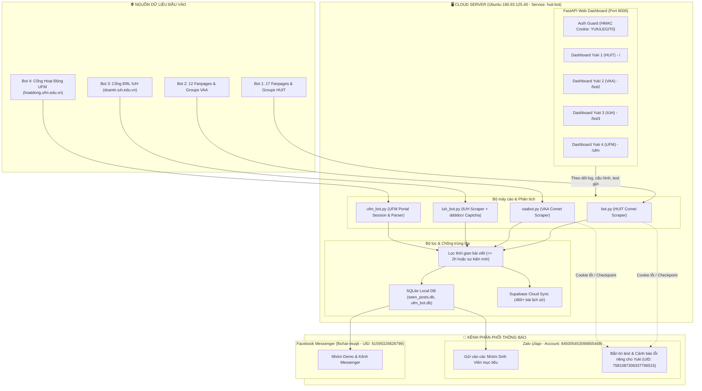

# 🏛️ HỆ THỐNG KIẾN TRÚC & CƠ CHẾ VẬN HÀNH 4 BOT (YUKI ECOSYSTEM)

> **Mục đích tài liệu:** Lưu giữ toàn bộ cấu trúc kiến trúc, luồng dữ liệu, cơ chế kỹ thuật và bảng tra cứu thông số quan trọng của hệ thống 4 Bot (HUIT, VAA, IUH, UFM). Khi cần bảo trì, cập nhật hoặc thêm tính năng trong tương lai, AI và lập trình viên chỉ cần đọc tài liệu này là nắm trọn vẹn 100% bối cảnh mà **không cần quét lại code hay tiêu tốn token**.

---

## 🗺️ 1. SƠ ĐỒ TỔNG QUAN KIẾN TRÚC HỆ THỐNG

---

## ⚙️ 2. CHI TIẾT 4 CON BOT

| Tiêu chí | Bot 1: Yuki 1 (HUIT) | Bot 2: Yuki 2 (VAA) | Bot 3: Yuki 3 (IUH) | Bot 4: Yuki 4 (UFM) | Bot 5: Yuki 5 (OU) |
| :--- | :--- | :--- | :--- | :--- | :--- |
| **Đơn vị** | ĐH Công Thương TP.HCM | Học viện Hàng Không VN | ĐH Công Nghiệp TP.HCM | ĐH Tài chính - Marketing | Trường ĐH Mở TP.HCM (OU) |
| **File chạy chính** | `bot.py` | `vaabot.py` | `iuh_bot.py` | `ufm_bot.py` & `vaa/ufm/bot.py` | `ou_bot.py` |
| **File cấu hình** | `config.json` | `config_bot2.json`, `vaabot.json` | `config_iuh.json` | `config_ufm.json`, `vaa/ufm/config.json` | `config_ou.json` |
| **Nguồn cào** | 17 Fanpages & Groups | 12 Fanpages & Groups | `doantn.iuh.edu.vn` | `hoatdong.ufm.edu.vn` | FB `diemrenluyenou` & Cổng `diemrl.ou.edu.vn` |
| **Cơ chế xác thực** | Cookie Facebook Desktop | Cookie Facebook Desktop | Session Cookie + OCR Captcha | Tài khoản portal: `2621008460` | Cookie FB VAA + SSO OU Captcha AI (`2654092020`) |
| **Database chống trùng** | `database.py` (`seen_posts.db`) | `database.py` (`seen_posts.db`) | `database.py` (bảng `iuh_posts`) | `ufm_bot.db` (bảng `ufm_activities`) | `ou_bot.db` (`seen_posts` & `seen_activities`) |
| **Chu kỳ quét** | Mỗi 60 giây | Mỗi 60 giây | Mỗi 120 giây | Mỗi 180 giây | Mỗi 25-30 giây (Keep-alive 90s) |
| **Đường dẫn Dashboard** | `/` (Trang chủ) | `/bot2` | `/bot3` | `/ufm` | `/bot5` hoặc `/ou` |

---

## 🔄 3. CƠ CHẾ VẬN HÀNH CHI TIẾT CÁC PHÂN HỆ

### 3.1. Phân hệ Cào Facebook (Bot 1 & Bot 2)
1. **Desktop SSR Comet Scraping**:
   - Sử dụng `requests.Session` kèm bộ headers Chrome Desktop thật (`User-Agent`, `Sec-Fetch-Dest: document`).
   - Tải thẳng mã HTML của Fanpage/Group để bóc tách các thẻ `<script>` chứa payload JSON phản hồi từ Facebook SSR.
   - Giải mã `message.text`, `creation_time`, `actors.name`, và `post_id`.
   - **Lưu ý tối quan trọng**: Không dùng `mbasic.facebook.com` vì Meta đã chặn trả về lỗi 400.
2. **Bộ lọc bài viết (Time & Content Filter)**:
   - Chỉ nhận bài viết có mốc `creation_time` đăng trong vòng **$\le$ 2.0 giờ**.
   - Bỏ qua các bài viết rỗng, bài chỉ chứa ảnh/link không kèm nội dung caption.
   - Tự động vào link chi tiết (`fetch_full_post_content`) nếu nội dung xem trước quá ngắn (< 120 ký tự) để cào trọn vẹn link Google Form / link đăng ký.
3. **Cơ chế Cảnh báo Cookie thông minh**:
   - Khi phát hiện checkpoint hoặc hết hạn session, bot tự động kích hoạt **Chế độ ẩn danh (Guest Mode)** để tiếp tục cào các Fanpage công khai.
   - Đồng thời tự động kích hoạt luồng bắn tin nhắn cảnh báo đến Zalo Admin Yuki (giới hạn tần suất 1 lần/giờ để không làm phiền).

### 3.2. Phân hệ Cào Cổng Đoàn - Hội IUH (Bot 3)
1. **Giải Captcha tự động bằng AI Local**:
   - Sử dụng thư viện `ddddocr` trên VPS để đọc ảnh Captcha dạng số từ `doantn.iuh.edu.vn`.
   - Tự động thử lại tối đa 5 lần nếu Captcha sai hoặc mạng chập chờn.
2. **Quản lý Session**:
   - Tự động duy trì cookie `.AspNetCore.Cookies` và `.AspNetCore.Antiforgery`.
   - Nếu session hết hạn, bot tự động kích hoạt hàm đăng nhập lại ngầm định mà không cần người dùng thao tác.

### 3.3. Phân hệ Cào Cổng Hoạt Động UFM (Bot 4)
1. **Xác thực Portal**:
   - Sử dụng tài khoản sinh viên `2621008460` / `focusoncareer2111`.
   - Tự động trích xuất token `__RequestVerificationToken` từ form đăng nhập.
2. **Cập nhật & Bền vững Cookie**:
   - Sau khi đăng nhập thành công, tự động ghi đè Cookie mới vào `config.json` để tái sử dụng cho các chu kỳ quét sau.
3. **Bóc tách bảng sự kiện**:
   - So sánh `id_hoat_dong` và tên sự kiện với bảng `ufm_activities` trong SQLite để phát hiện ngay sự kiện mới mở đăng ký ĐRL.

---

## 📡 4. CƠ CHẾ PHÂN PHỐI TIN NHẮN (DISPATCHER PIPELINE)

### 4.1. Kênh Zalo (`zalo_sender.py`)
- **Tài khoản Bot (Sender)**: Đăng nhập bằng Cookies & IMEI (`833054fc-...`), UID Zalo: `845005453098855468` (Phone: `+84384346537`).
- **Tài khoản Quản trị & Nhận cảnh báo (Admin Recipient)**:
  - **Tên hiển thị**: `Yuki`
  - **UID Zalo**: `7581087306337796515`
  - **Quyền hạn**: Nhận tin nhắn kiểm tra (Test Single/All), nhận cảnh báo khi Cookie Facebook/Zalo gặp sự cố.
- **Kênh nhóm (Groups)**: Gửi tin định dạng đẹp mắt kèm thẻ `#DRL`, tiêu đề, tóm tắt nội dung và link gốc bài viết vào danh sách `target_groups` cấu hình trong file JSON.

### 4.2. Kênh Facebook Messenger (`messenger_sender.py`)
- **Tài khoản Bot**: UID `61595329828799` (Yu Ki).
- **Cơ chế**: Sử dụng thư viện `fbchat-muqit` duy trì kết nối WebSocket thời gian thực tới MQTT broker của Meta (`edge-chat.facebook.com`).
- Tự động hẹn giờ tái kết nối mỗi 30 - 45 phút để tránh rớt socket mạng.

---

## 🔐 5. BẢO MẬT & TRUY CẬP WEB DASHBOARD

- **URL Dashboard**: `http://180.93.125.40:8000/`
- **Mật khẩu bảo vệ**: `YUKILEGIT0`
- **Cơ chế Authentication Guard**:
  - Middleware kiểm tra Cookie đã ký HMAC `yuki_auth_session`.
  - Nếu chưa đăng nhập hoặc cookie không hợp lệ ➔ Chuyển hướng ngay về trang `/login` (với các API trả về `401 Unauthorized`).
  - Hỗ trợ lưu phiên đăng nhập 30 ngày (Remember Me).
  - Nút **Thoát (Logout)** trên thanh điều hướng cho phép xóa phiên tức thì.
- **Che giấu thông tin nhạy cảm**: Tuyệt đối không để lộ IP máy chủ hoặc đường dẫn hệ thống nội bộ trong các mẫu tin nhắn gửi vào Zalo / Messenger (thay thế bằng nhãn chuẩn `🌐 Hệ thống: Cloud Server 24/7`).

---

## 📋 6. BẢNG TRA CỨU NHANH THÔNG SỐ VẬN HÀNH

| Thông số / Tác vụ | Giá trị / Lệnh thực thi |
| :--- | :--- |
| **IP VPS** | `180.93.125.40` (Port SSH: `22`, User: `root`, Pass: `2tLGYzo2Ihgl6wKX`) |
| **Systemd Service** | `huit-bot` (`systemctl restart huit-bot`, `systemctl status huit-bot`) |
| **Xem log VPS trực tiếp** | `journalctl -u huit-bot -f` |
| **Mật khẩu Web Dashboard** | `YUKILEGIT0` |
| **Zalo Bot Sender** | UID `845005453098855468` (Phone: `+84384346537`) |
| **Zalo Admin Recipient** | UID `7581087306337796515` (Tên: `Yuki`) |
| **Messenger Bot Sender** | UID `61595329828799` |
| **Đồng bộ mã nguồn lên VPS** | `python sync_to_vps.py` (Tự tải file, kiểm tra biên dịch, khởi động lại service) |
| **Đồng bộ mã nguồn lên GitHub** | `python github_sync.py` (Đẩy Git Commit tự động qua API không cần git CLI) |
| **Kho GitHub Repo** | `https://github.com/yukilegit11-creator/huit-bot` |
| **Thêm mục cào mới (Target)** | Thêm `{ "name": "...", "url": "...", "enabled": true }` vào `targets` trong `config.json` hoặc `config_bot2.json` |
| **Thêm nhóm Zalo nhận tin** | Thêm `{ "id": "...", "name": "...", "type": "GROUP", "enabled": true }` vào `target_groups` trong config tương ứng |
| **Cập nhật Cookie Facebook** | Dán JSON cookies vào mục Cấu hình trên Web Dashboard (hoặc ghi đè trường `fb_cookies` trong `config.json` / `config_bot2.json`) |

---

> [!TIP]
> **Kinh nghiệm vàng khi bảo trì:** Khi có sự cố không cào được bài, hãy kiểm tra theo đúng thứ tự 3 bước:
> 1. Kiểm tra trạng thái service: `systemctl status huit-bot`.
> 2. Kiểm tra log cào: Xem `journalctl -u huit-bot -n 50 --no-pager`.
> 3. Nếu log báo cào 0 bài liên tục: Thử kiểm tra xem Fanpage mục tiêu có bài mới trong vòng 2 tiếng gần nhất hay không trước khi nghi ngờ lỗi cookie.
